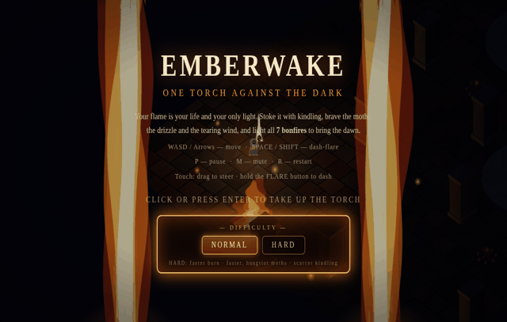
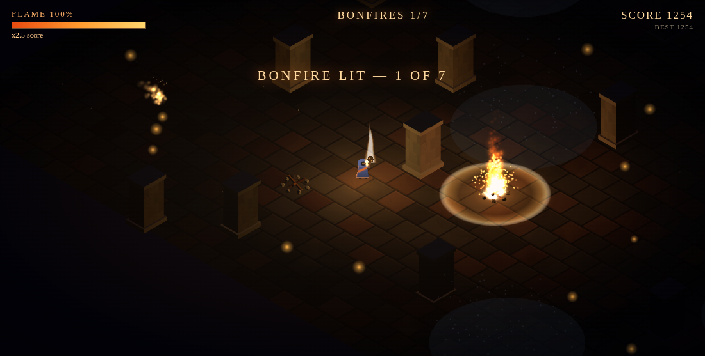
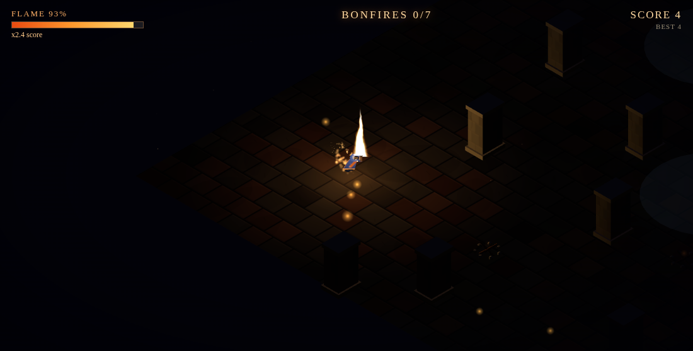

# EMBERWAKE

**One torch against the dark.**

▶ **[Play it in your browser](https://retroromrunner.github.io/emberwake/)** · also on [itch.io](https://retroromrunner.itch.io/emberwake)

You are the last torchbearer of a drowned kingdom. Your flame is your life
and your only light — stoke it with kindling, brave the shadow moths, the
drizzle and the tearing wind, and light all **7 bonfires** to bring the dawn.

The bonfires move every run. The dark does not care.

## How to play

- **WASD / Arrow keys** — move (camera-relative, diagonals included)
- **SPACE / SHIFT** — dash-flare: a burst of flame that burns moths and
  pushes back the dark, at the cost of your flame
- **Touch** — drag to steer, hold the FLARE button to dash
- **P** pause · **M** mute · **R** restart · **H** difficulty

Keep your flame alive: it drains over time, faster in the drizzle and when
the wind gusts outside shelter. Kindling wisps are scattered through the
ruins — gathering them is the only way to feed the flame.

## Difficulty

- **NORMAL** — the game as intended. Lighting a bonfire restores your flame.
- **HARD** — the tiles themselves turn ember-red. The flame burns far
  faster, the moths are quicker and hungrier, kindling is scarce — and
  lighting a bonfire does **not** refuel you. Only kindling does. Every
  route between pyres is a wager.

## The fires

Three different fires burn in EMBERWAKE:

- The **title screen** is framed by two great walls of layered silhouette
  flame and a grand center flame, with sparks spinning off into the dark —
  a tribute to the game's 2D origins.
- Your **torch** is a living shader flame that gutters, sputters and flares
  with your dash, and its flickering light is all that holds back the dark.
- A lit **bonfire** is a true 3D particle fire — hundreds of swirling
  particles running white-hot at the base to deep red at the tips.

## About

Built for **AI Browser Game Jam 5** (theme: **TORCH**). An isometric
Three.js game in a single HTML file — every texture, sprite, sound and
song of the dark is generated procedurally in code; there are no asset
files. The synthesized audio (fire rumble, crackle, wind, the great burn
of a lighting pyre) is all WebAudio, made at runtime.

*The original 2D version of EMBERWAKE is preserved under the
[v1.0 release](https://github.com/retroromrunner/emberwake/releases/tag/v1.0).*
