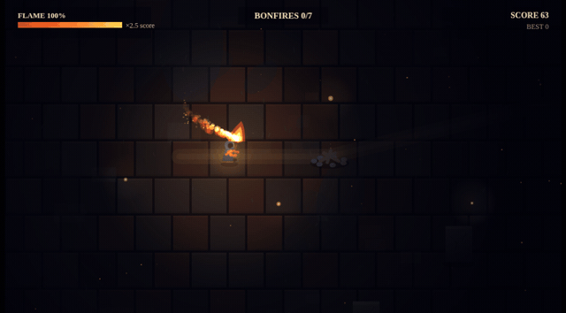
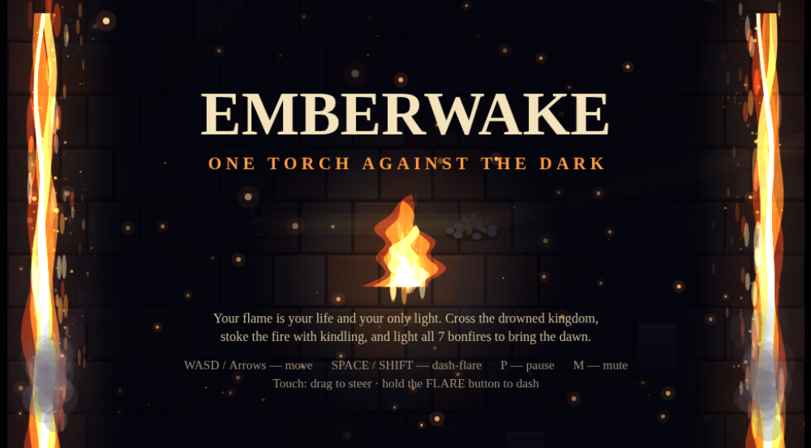

# EMBERWAKE

**One torch against the dark.**

### ▶ Play it now: https://retroromrunner.github.io/emberwake/
*(mirror: https://civic-petal-874k.here.now/)*

You are a lone torchbearer crossing a pitch-dark drowned kingdom. Your torch
flame is both your health *and* your only light — when it dies, so do you.
Stoke it with kindling, brave the moths, the drizzle, and the tearing wind,
and light all **7 bonfires** scattered through the night to bring the dawn.

## How to play

- **WASD / Arrow keys** — move
- **SPACE / SHIFT** — dash-flare: your flame erupts, burning shadow moths and
  leaving a trail of fire — but every flare costs fuel
- **P** — pause · **M** — mute · **R** — restart
- **Touch:** drag anywhere to steer toward your finger; hold the on-screen **FLARE** button (bottom-right) to dash-flare

## The night

- Your flame **constantly burns down**. Glowing **kindling wisps** stoke it
  back up. A bigger flame means a bigger circle of light — and a bigger
  score multiplier.
- **Shadow moths** drift out of the dark, drawn to your light. On contact
  they drink your flame. Burn them with a dash-flare.
- **Wind gusts** are telegraphed — embers stream sideways and the wind
  rises — then tear at your flame for a few seconds. Shelter in the **lee of
  stone pillars** until they pass.
- **Drizzle patches** hiss on the flame and burn it down twice as fast.
- Touch a cold **bonfire pyre** with a healthy flame to ignite it: a burst
  of embers, a full refill, and a checkpoint of light in the dark. Light all
  seven and dawn breaks.
- If the flame reaches zero, it gutters out. Your best score is remembered.

## Screenshots

## About

A single self-contained HTML file — no build step, no assets, everything
drawn and sounded procedurally (including the fire, the torchbearer sprite,
and the full WebAudio soundscape). Built with AI assistance for the
[AI Browser Game Jam 5](https://itch.io/jam/ai-jam-5) (theme: TORCH).
